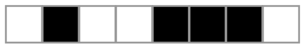

Sarah möchte Folgen von schwarzen und weißen Kästchen mit Buchstaben beschreiben. Sie wendet dazu diesen Algorithmus auf eine Kästchen-Folge an:

- Wenn alle Kästchen der Folge weiß sind, schreibe **W**.
- Wenn alle Kästchen der Folge schwarz sind, schreibe **S**.
- Wenn die Folge schwarze und weiße Kästchen enthält, schreibe **x** und mache Folgendes:
  - Wende den Algorithmus auf die linke Hälfte der Folge an.
  - Wende den Algorithmus auf die rechte Hälfte der Folge an.

Hier siehst du für einige Kästchen-Folgen, welche Buchstaben-Beschreibung der Algorithmus ausgibt:

- Acht weiße Kästchen: **W**
- Vier weiße, dann vier schwarze: **xWS**
- Zwei schwarze, zwei weiße, vier schwarze: **xxSWS**
- Vier schwarze, zwei weiße, ein schwarzes, ein weißes: **xSxWxSW**

**Welche Buchstaben-Beschreibung gibt Sarahs Algorithmus für diese Kästchen-Folge aus?**

