Die richtige Beschreibung ist **xxxWSWxSxSW**.

Wir wenden den Algorithmus auf die Kästchen-Folge an und konstruieren die Buchstaben-Beschreibung Schritt für Schritt. In den Bildern ist die Kästchenfolge, auf die der Algorithmus gerade angewendet wird, gelb markiert.

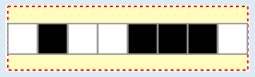

**x** – Die Folge enthält schwarze und weiße Kästchen, also schreibt der Algorithmus x und wendet sich selbst auf die linke Hälfte der Folge an.

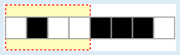

**xx** – Die Folge enthält schwarze und weiße Kästchen, also schreibt der Algorithmus x und wendet sich selbst auf die linke Hälfte der Folge an.

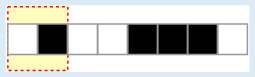

**xxx** – Die Folge enthält schwarze und weiße Kästchen, also schreibt der Algorithmus x und wendet sich selbst auf die linke Hälfte der Folge an.

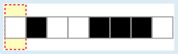

**xxxW** – Alle Kästchen der Folge sind weiß, also schreibt der Algorithmus W. Damit wird der Algorithmus für diese Folge beendet und nun auf die rechte Hälfte der vorigen Folge angewendet.

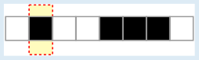

**xxxWS** – Alle Kästchen der Folge sind schwarz, also schreibt der Algorithmus S und wird danach auf die rechte Hälfte der vorigen Folge angewendet.

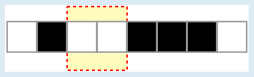

**xxxWSW** – Alle Kästchen der Folge sind weiß, also schreibt der Algorithmus W. Jetzt haben wir die linke Hälfte der gesamten Folge verarbeitet und können nun den Algorithmus auf die rechte Hälfte anwenden.

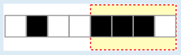

**xxxWSWx** – Die Folge enthält schwarze und weiße Kästchen, also schreibt der Algorithmus x und wendet sich selbst auf die linke Hälfte der Folge an.

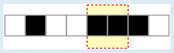

**xxxWSWxS** – Alle Kästchen der Folge sind schwarz, also schreibt der Algorithmus S und wird danach auf die rechte Hälfte der vorigen Folge angewendet.

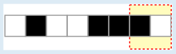

**xxxWSWxSx** – Die Folge enthält schwarze und weiße Kästchen, also schreibt der Algorithmus x und wendet sich selbst auf die linke Hälfte der Folge an.

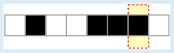

**xxxWSWxSxS** – Alle Kästchen der Folge sind schwarz, also schreibt der Algorithmus S und wird danach auf die rechte Hälfte der vorigen Folge angewendet.

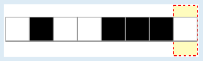

**xxxWSWxSxSW** – Alle Kästchen der Folge sind weiß, also schreibt der Algorithmus W. Jetzt haben wir auch die rechte Hälfte der gesamten Folge verarbeitet und sind fertig.

## Das ist Informatik!

Sarahs Algorithmus hat eine ganz besondere Eigenschaft: Wenn die eingegebene Kästchen-Folge farblich gemischt ist, wendet er sich sozusagen selbst an, und zwar nacheinander auf die linke und die rechte Hälfte der Eingabe. Damit wird die Aufgabe, die Eingabe als Buchstabenfolge zu beschreiben, in zwei kleinere Teilaufgaben zerlegt. Das ist unter anderem dann sinnvoll, wenn die Teilaufgaben leichter zu bearbeiten sind als die gesamte Aufgabe. Die Aufteilung von Problemen in (hoffentlich leichtere) Teilprobleme ist in der Informatik unter dem Namen „divide and conquer“ bekannt, gemäß der im antiken Rom bekannten Herrschaftsstrategie „divide et impera“, auf Deutsch „teile und herrsche“. Wenn ein Lösungsverfahren die Teilaufgaben auf die gleiche Weise angeht wie die gesamte Aufgabe, sich also selbst auf die Teilaufgaben anwendet und dann insbesondere die Teilaufgaben wieder in kleinere Teile zerlegt, folgt das Verfahren gleichzeitig dem Prinzip der *Rekursion* – so wie Sarahs Algorithmus in dieser Biberaufgabe. Rekursion wird in der Informatik sehr häufig genutzt, ob beim Sortieren von Daten, bei der Konstruktion von Dateisystemen und vieles mehr.

Sarahs Algorithmus beschreibt bzw. *kodiert* die Kästchen-Folgen mit Buchstaben. Eine Kodierung muss umkehrbar sein; es muss also ein Verfahren geben, die Buchstaben wieder in die originale Kästchenfolge umzuwandeln. Wenn die Buchstaben-Beschreibung um die Anzahl der Kästchen in der beschriebenen Folge ergänzt wird, ist das problemlos möglich. Überlege dir, wie! Möglicherweise benötigst du auch dafür einen rekursiven Algorithmus. Im Idealfall ist die Kodierung, die Sarahs Algorithmus ausgibt, sehr viel kürzer als die eingegebene Kästchenfolge. Zum Beispiel wird eine Folge von 1024 weißen Kästchen mit einem einzigen W beschrieben. Sarahs Algorithmus betreibt also nicht nur Kodierung, sondern auch *Datenkompression* (platzsparende Beschreibung von Daten), und folgt dabei ähnlichen Ideen wie Verfahren zur Kompression von Bilddaten (etwa ins Foto-Format JPEG) oder Videodaten.
