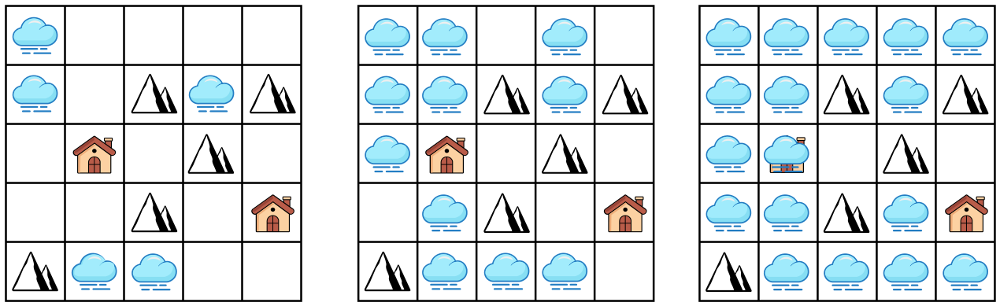

Im Land der Berge ist heute Nebel, und der breitet sich mit jeder Stunde weiter aus.

Bei Sonnenaufgang bedeckt der Nebel nur einige Regionen. In jeweils einer Stunde breitet sich der Nebel von jeder bisherigen Nebelregion in alle ihr benachbarten Regionen aus; nach rechts, links, oben oder unten. Dadurch werden auch Häuser vom Nebel bedeckt. Nur in die Bergregionen kann der Nebel sich nicht ausbreiten.

Ein Beispiel:

**Welches Haus im Land wird als letztes vom Nebel bedeckt?**
