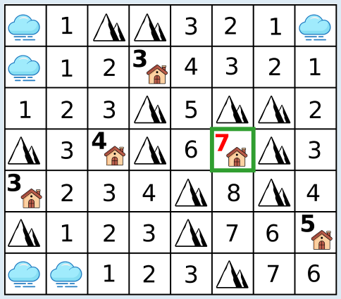

Der Nebel verbreitet sich wie eine Flut über das Land: zuerst auf die benachbarten Regionen der Nebelregionen, dann auf die Nachbarn der Nachbarn (die noch nicht benebelt sind), und so weiter. Eigentlich müsste man nur zusehen, bis alle Häuser außer einem unter dem Nebel verschwunden sind. Dann ist die richtige Antwort gefunden.

Im Bild ist die Region des Hauses grün markiert, welches als letztes vom Nebel bedeckt wird. Es zeigt auch für jede Region, wie viele Stunden es gedauert hat, bis sie vom Nebel bedeckt war. Man sieht: Das markierte Haus hat von allen Häusern die höchste Zahl, und es gibt nur ein Haus mit dieser Zahl, so dass die Antwort eindeutig ist: 7.

Man kann sich auch etwas anderes überlegen: Dasjenige Haus wird als letztes vom Nebel bedeckt, das zu Beginn am weitesten von einer Nebelregion entfernt ist. Also kann man für alle Häuser diese Entfernung messen und so die richtige Antwort bestimmen. Dabei ist zu beachten: Die Entfernung von einem Haus zum Nebel misst sich entlang der Ausbreitung des Nebels, über die nicht-diagonal benachbarten Regionen und um die Bergregionen herum. Dieses Vorgehen würde aber deutlich länger dauern als das obige, denn man hätte für *n* Häuser und *m* ursprüngliche Nebelregionen *n* × *m* Entfernungen zu berechnen.

Interessant ist, dass ein schneller, menschlicher Blick sich hier täuschen lassen kann: Auf Anhieb könnte man das Haus rechts unten als am weitesten entfernt von allen ursprünglichen Nebelregionen vermuten. Weil auf dem Weg zu diesem Haus dem Nebel keine Berge im Weg sind, ist es aber schneller erreicht als das Haus der richtigen Antwort.

## Das ist Informatik!

Der Nebel in dieser Biberaufgabe flutet nach und nach die Regionen des Landes, die von mindestens einer der ursprünglichen Nebelregionen entlang des Ausbreitungswegs des Nebels erreichbar sind. Ein Gebiet aus allen Regionen, die von einer einzigen Nebelregion aus erreicht werden kann, können wir auch als *zusammenhängendes Gebiet* bezeichnen. Im Nebel-Land dieser Aufgabe bilden alle Regionen ein einziges zusammenhängendes Gebiet. Ein einziger weiterer Berg in der zweiten Zeile von oben, viertes Feld von rechts würde dafür sorgen, dass die Regionen des Landes in zwei zusammenhängende Nebel-Gebiete aufgeteilt wären.

Zusammenhängende Gebiete sind auch für die Informatik interessant, und zwar in unterschiedlichen Bereichen. Ein einfarbiger Bereich in einem (Computer-)Bild ist ein zusammenhängendes Gebiet gleichfarbiger Pixel; man kann es mit einem *Floodfill-Algorithmus* bestimmen, der so ähnlich funktioniert wie die Nebelausbreitung in dieser Biberaufgabe. Eine Gruppe von Jugendlichen, in denen jeder mindestens mit einem anderen Jugendlichen der Gruppe befreundet ist, ist ebenfalls ein zusammenhängendes Gebiet, wenn man die Freundschaftsbeziehung als Nachbarschaft betrachtet. Auf ganz ähnliche Weise kann man die „Blasen“ in einem sozialen Netzwerk als zusammenhängende Gebiete betrachten. Auch für solche Netzwerke kennt die Informatik Methoden, zusammenhängende Gebiete zu bestimmen, etwa die Breitensuche oder die Tiefensuche. Mit Methoden zur Bestimmung zusammenhängender Gebiete können zum Beispiel Bereiche in Bildern umgefärbt oder Gruppierungen in sozialen Netzwerken ermittelt werden.
