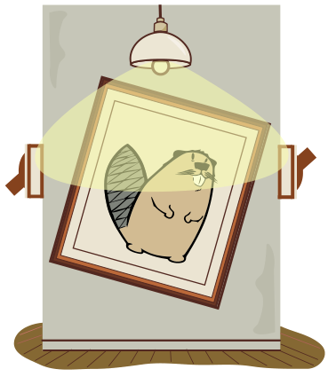
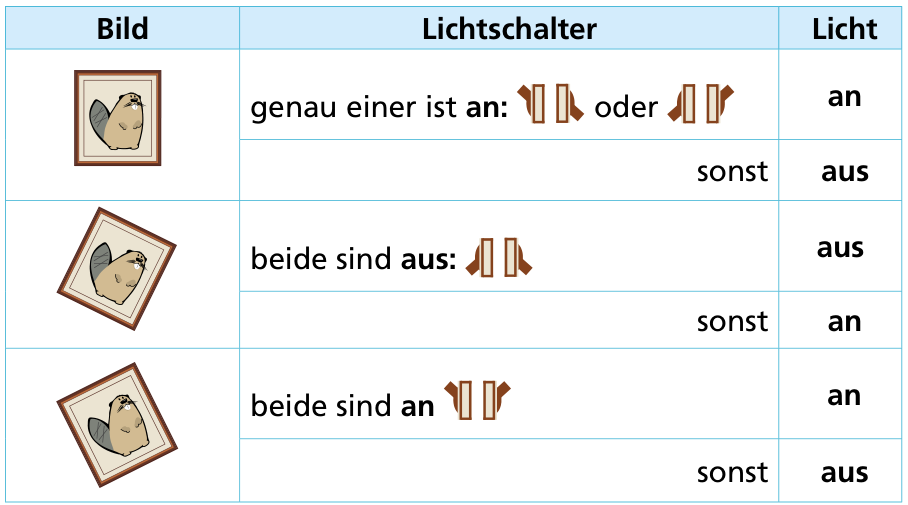

Viktoria Volt hat eine verrückte Lampe gebaut. Die Lampe hat zwei Lichtschalter: einer links und einer rechts. Jeder Lichtschalter kann entweder **an** (Schalter oben) oder **aus** (Schalter unten) sein.

Die verrückte Lampe hat aber noch einen dritten, geheimen Schalter: ein Bild! Je nachdem, wie das Bild hängt (gerade, nach links oder nach rechts gekippt), funktionieren die Lichtschalter anders.

Diese Tabelle sagt, wie die Schalter jeweils das Licht an oder aus machen:

Der linke Lichtschalter ist **aus**, der rechte Lichtschalter ist **an**.

**Wie muss das Bild hängen, damit das Licht aus ist?**
