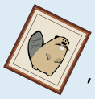

Wenn das Bild nach links gekippt hängt, ist das Licht aus.

Wir schauen alle drei Möglichkeiten, wie das Bild hängen kann, genauer an:

- **Bild gerade:** Weil genau ein Schalter an ist (nämlich der rechte), ist das Licht an. Diese Antwort ist falsch.
- **Bild nach rechts gekippt:** Weil nicht beide Lichtschalter aus sind, ist das Licht an. Auch diese Antwort ist falsch.
- **Bild nach links gekippt:** Weil nicht beide Lichtschalter an sind, ist das Licht aus. Diese Antwort ist richtig.

## Das ist Informatik!

Viktorias Lichtschalter können jeweils zwei Werte haben: *an* oder *aus*. Und auch das Licht hat nur diese beiden Werte. In jeder Position des Bildes lässt sich der Wert des Lichts aus den Werten der Schalter ausrechnen, und zwar so, wie in der Tabelle angegeben.

Auch die kleinste Speichereinheit in Computern, nämlich das *Bit*, kann nur zwei Werte annehmen. In der Informatik heißen diese Werte häufig auch *an* und *aus*, manchmal aber auch *wahr* und *falsch* oder auch *1* und *0*. So wie man Zahlen mit Operatoren (+, –, ×, :) kombinieren und daraus neue Werte berechnen kann, kann man Bits mit *logischen Operatoren* kombinieren. In Computern sind diese Operatoren als *logische Gatter* eingebaut. Mit den Gattern kann man Bits auf nur alle erdenklichen Arten kombinieren und verrechnen. Deshalb können Computer Daten auf fast beliebige Weise verarbeiten und verändern.

Das Bild in dieser Biberaufgabe entscheidet, welche logische Operation die beiden Lichtschalter umsetzen. Hängt das Bild gerade, funktionieren die Schalter wie ein XOR („entweder oder“): Wenn entweder der linke oder der rechte Schalter an ist, ist das Licht an. Hängt das Bild nach rechts gekippt, funktionieren sie wie ein OR („oder“): Wenn der linke Schalter oder der rechte (also beide oder einer von beiden) an ist, ist das Licht an. Hängt das Bild nach links gekippt, funktionieren die Schalter wie ein AND („und“): Wenn der linke und der rechte Schalter (beide gleichzeitig) an ist, ist das Licht an.
