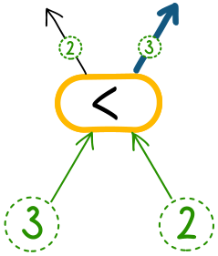

Die Biber haben eine Zahlenmaschine.

Vier Zahlen werden unten in die Eingabefelder eingegeben, zum Beispiel 3, 4, 2 und 1.

Entlang von Pfeilen und Schaltern (gelbe Kästchen mit „<“) wandern die Zahlen durch die Maschine nach oben bis zu den Ausgabefeldern.

Jeder der fünf Schalter vergleicht die beiden eingehenden Zahlen und leitet …

- … die kleinere Zahl nach links und
- … die größere Zahl nach rechts weiter.

Etwa so:

**Welche Aufgabe führt die Maschine aus?**
