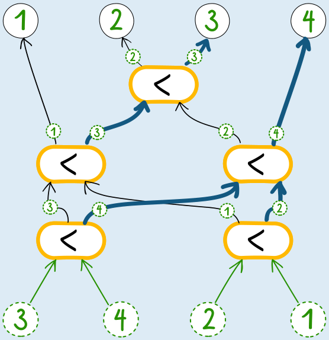

**Antwort D ist richtig:** Die Zahlenmaschine sortiert die Zahlen in aufsteigender Reihenfolge. Im Beispiel: 1, 2, 3, 4.

Durch Ausprobieren der Maschine kann man sowohl die richtige Antwort feststellen als auch alle anderen Antworten ausschließen.

Die Zahlenmaschine macht in einem ersten Schritt zwei Vergleiche von je zwei Zahlen. Danach vergleicht sie zum einen die beiden größeren und zum anderen die beiden kleineren Zahlen aus den ersten beiden Vergleichen miteinander, um den insgesamt größten Wert (Maximum) bzw. insgesamt kleinsten Wert (Minimum) der vier Zahlen zu ermitteln. Durch einen Vergleich der übrigen beiden Zahlen ist die Sortierung dann vollständig.

## Das ist Informatik!

In der Informatik ist die Zahlenmaschine aus dieser Biberaufgabe als *Sortiernetzwerk* bekannt. Ein Sortiernetzwerk besteht aus einer Reihe identischer, sehr einfacher Komponenten, den *Komparatoren*. Jeder Komparator empfängt zwei numerische Werte auf zwei Eingangsleitungen und vergleicht sie. Dann leitet er die Werte auf zwei Ausgangsleitungen weiter: den kleineren Wert auf der linken Leitung und den größeren Wert auf der rechten Leitung. (Häufig werden Sortiernetzwerke auch quer dargestellt, mit den Eingängen links und Ausgängen rechts und den Komparatoren als Brücken zwischen zwei Leitungen; dann wird die kleinere Zahl in der Regel nach oben und die größere Zahl nach unten geleitet.)

Durch die Kombination einer ausreichenden Anzahl von Komparatoren kann jede Zahlenfolge sortiert werden. Die Zahlenmaschine in dieser Biberaufgabe zeigt, dass vier Zahlen mit fünf Komparatoren sortiert werden können. Für fünf Zahlen sind mindestens neun und für sechs Zahlen mindestens zwölf Komparatoren erforderlich.

Sortiernetzwerke sind in der Informatik von praktischer Bedeutung, weil Komparatoren als sehr einfache und daher kostengünstige elektronische Bauteile und damit Sortiernetzwerke auch insgesamt gut in Hardware realisiert werden können. Außerdem können die Komparatoren zum Teil gleichzeitig arbeiten, was die Sortierung beschleunigt: Im Allgemeinen ist die Anzahl der nicht-parallelen Schritte eines Sortiernetzwerks kleiner als die Anzahl der zu sortierenden Zahlen. Ein Nachteil von Sortiernetzwerken ist, dass sie jeweils nur für Eingaben von fester Länge ausgelegt sind.
